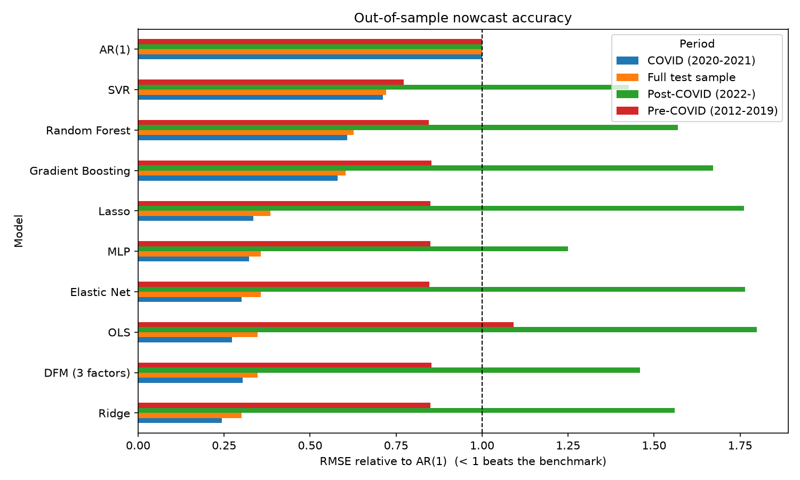

# Nowcasting US GDP Growth with a Dynamic Factor Model and Machine Learning

GDP is published with a lag of about a month after the quarter ends, and revised after that.
*Nowcasting* estimates the current quarter's growth from indicators that arrive sooner:
industrial production, payrolls, retail sales, surveys, prices and financial data.

This project applies the approach of IMF Working Paper WP/22/52, *Nowcasting GDP: A Scalable
Approach Using DFM, Machine Learning and Novel Data, Applied to European Economies*
(Dauphin et al., 2022), to the United States. It compares a dynamic factor model and eight machine
learning models against an AR(1) benchmark, using 22 monthly FRED indicators.

The written summary of the IMF paper and the first version of the replication are in
[`docs/nowcasting_USA_report.pdf`](docs/nowcasting_USA_report.pdf).

## Results

Pseudo out-of-sample nowcasts for 2012Q1–2026Q2 (58 quarters). Each quarter is predicted by models
trained only on earlier quarters, using indicators observed during that quarter.
RMSE is in percentage points of annualised growth; a ratio below 1 beats the AR(1) benchmark.

| Model | RMSE vs AR(1): 2012–2019 | 2020–2021 (COVID) | 2022 onwards | Full sample |
|---|---|---|---|---|
| Ridge | 0.85 | **0.24** | 1.56 | **0.30** |
| DFM (3 factors) | 0.85 | 0.30 | 1.46 | 0.35 |
| Elastic Net | 0.85 | 0.30 | 1.76 | 0.36 |
| MLP | 0.85 | 0.32 | 1.25 | 0.36 |
| Lasso | 0.85 | 0.34 | 1.76 | 0.39 |
| Gradient Boosting | 0.85 | 0.58 | 1.67 | 0.60 |
| Random Forest | 0.85 | 0.61 | 1.57 | 0.63 |
| SVR | **0.77** | 0.71 | 1.43 | 0.72 |
| AR(1) RMSE (pp) | 1.64 | 23.79 | **1.45** | 8.96 |



**What this shows**

- **Normal times (2012–2019):** most models cut the AR(1) error by about 15%; SVR does best (23%).
- **COVID shock:** indicator-based models are essential. AR(1) cannot anticipate the 2020Q2
  collapse, while Ridge and the DFM track it and cut the error by 70–75%. Tree-based models do
  worse here because they cannot extrapolate beyond values seen in training.
- **After 2022 nothing beats AR(1).** Growth has been steady, and the relationship between
  indicators and GDP was distorted by the pandemic years in the training data. This matches the
  IMF paper's finding that gains over simple benchmarks depend heavily on the period.
- Linear shrinkage (Ridge) and the factor model are the most reliable overall, consistent with the
  paper's results for Austria, Hungary and Poland.

Metrics saved in `outputs/scores.csv` include RMSE, MAE and mean directional accuracy (MDA).
Each model also has a nowcast-vs-actual plot in `outputs/`.

## Data

All series come from FRED and are downloaded directly; no API key is needed. Monthly and daily
series are averaged to quarters, then made stationary:

| Transformation | Series |
|---|---|
| Annualised log growth | Industrial production, retail sales, CPI, PPI, oil price, S&P 500, housing starts, M2, payrolls, durable goods orders, building permits, real disposable income, business inventories, job openings, exports, import prices |
| First difference | Unemployment rate, consumer sentiment, 10-year Treasury yield, capacity utilisation |
| Level | Empire State and Philadelphia Fed surveys (diffusion indices) |

The target is real GDP growth, % SAAR (`A191RL1Q225SBEA`). The sample starts in 2001 because
JOLTS job openings begin in December 2000. FRED only provides the last 10 years of the S&P 500, so
that series enters the models only once it has enough history (indicators need 80% coverage in
the training window).

## Run it

```bash
pip install -r requirements.txt
```

```bash
python run_nowcast.py
```

Optional flags: `--refresh` re-downloads the data (otherwise `data/fred_raw.csv` is reused),
`--test-start 2015-01-01` changes the evaluation window, and `--kalman-dfm` also fits a
state-space DFM in-sample with statsmodels.

```bash
python -m pytest
```

## Layout

```
nowcast/data.py       FRED download, quarterly aggregation, stationarity transforms
nowcast/models.py     AR(1), two-step DFM, ML models, optional Kalman-filter DFM
nowcast/evaluate.py   Expanding-window evaluation and RMSE / MAE / MDA by period
run_nowcast.py        Runs everything and writes outputs/
scripts/              Helper to crop the IMF paper's charts (page 18)
tests/                Includes a check that no future data leaks into a nowcast
```

## Improvements over the first version

- **Out-of-sample evaluation.** The original models were fit on the full sample and plotted against
  the same data they were trained on, which overstates accuracy. Every nowcast is now made
  with an expanding window, and a test confirms that changing future data does not change past
  nowcasts.
- **Stationary inputs.** Levels such as CPI, M2 and payrolls trend upward and were used directly.
  They are now transformed to growth rates or differences, as in the IMF paper.
- **DFM on the right scale.** The DFM predictions were standardised values plotted against GDP
  growth in percent. Predictions are now on the original scale.
- **A workable number of factors.** 12 factors for 23 series failed to converge. The evaluation
  uses a 3-factor two-step DFM (principal components, then regression).
- **Benchmark and metrics.** All models are scored against AR(1) with RMSE, MAE and directional
  accuracy, split into pre-COVID, COVID and post-COVID periods.
- **Tuning without leakage.** Penalties for Lasso and Elastic Net are chosen by time-series
  cross-validation inside each training window; scaling and imputation are refit each quarter.
- **Reliable data download.** `pandas_datareader` breaks with recent pandas versions; data now come
  straight from FRED's CSV endpoint, with retries and a local cache. Industrial production was
  listed twice in the original series list.

## Limitations

- Uses final revised data, not the vintages available in real time (ALFRED would allow this).
- Indicators are full-quarter averages, so this is a nowcast made at the end of the quarter. A
  production nowcast would also handle partially observed quarters (the "ragged edge"), for
  example with statsmodels' `DynamicFactorMQ`.
- The novel data used in the IMF paper (Google Trends, mobility, air quality) are not included.

## Reference

Dauphin, J.-F., Dybczak, K., Maneely, M., Sanjani, M. T., Suphaphiphat, N., Wang, Y., & Zhang, H.
(2022). *Nowcasting GDP: A Scalable Approach Using DFM, Machine Learning and Novel Data, Applied to
European Economies.* IMF Working Paper WP/22/52.

## Author

Mahamane Bachir Sadou
